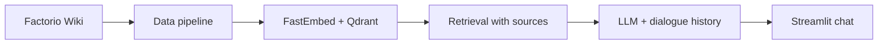

# Factorio Wiki RAG


An educational retrieval project for [Factorio Wiki](https://wiki.factorio.com/), covering items, recipes, research and mechanics from the base game and Space Age. English articles are collected, cleaned and split into source-linked chunks, then embedded with FastEmbed and searched through local Qdrant.

**Implemented:** data collection, preprocessing, E5 embeddings, Qdrant retrieval, cited LLM answers and a Streamlit chat with session memory. Follow-up questions are rewritten using recent dialogue history.



## Layout

```text
src/
├── data_pipeline/    # parser.py and preprocess.py
├── database/         # index.py, query.py and retriever.py
├── rag/              # Conversation orchestration and LLM generation
├── config.py         # Shared environment settings
└── contracts.py      # Search, history and answer formats
streamlit-app/        # Chat interface
deploy/               # Container setup and complete app dependencies
data/                 # Raw pages, cleaned articles and chunks
qdrant_db/            # Local vector database
clear_raw.bat
clear_processed.bat
requirements.txt
```

See the [source overview](src/README.md), [data pipeline](src/data_pipeline/README.md) and [database](src/database/README.md). Generated data, the database and virtual environments are excluded from Git.

## Setup and run

Requires Python 3.10+. Run these PowerShell commands from the repository root after cloning it. Internet access is needed for installation, collection and the initial model download.

```powershell
python -m venv .venv
.\.venv\Scripts\python.exe -m pip install -r requirements.txt

.\.venv\Scripts\python.exe -m src.data_pipeline.parser
.\.venv\Scripts\python.exe -m src.data_pipeline.preprocess
.\.venv\Scripts\python.exe -m src.database.index
.\.venv\Scripts\python.exe -m src.database.query
```

The indexer reads `data/processed/chunks.jsonl`. Paths and model settings come from `src/config.py`, with environment overrides.

If a complete raw dataset is already available, start with preprocessing. To resume an incomplete collection, run the parser again; it skips existing files and downloads missing pages. To refresh saved pages from the Wiki, clear raw first and repeat the pipeline.

Qdrant defaults to `qdrant_db/` at the project root; run indexing and the app sequentially. The model is `intfloat/multilingual-e5-large` (1024 dimensions). CLI search accepts quoted questions and searches all sections. Similarity scores are not confidence probabilities. Rebuild the database when changing the model or dataset.

## Chat with memory

Install the full application dependencies, set private LLM connection settings, then launch:

```powershell
.\.venv\Scripts\python.exe -m pip install -r deploy/requirements.txt
$env:MISTRAL_API_KEY = '<private API key>'
$env:MISTRAL_MODEL = '<model ID>'
$env:MISTRAL_BASE_URL = '<compatible API base URL>'
.\.venv\Scripts\python.exe -m streamlit run streamlit-app/app.py
```

For the provider's default endpoint, omit `MISTRAL_BASE_URL`. Variables are read from the process environment; local `.env` files are not loaded automatically. Memory keeps the latest `HISTORY_TURNS` successful turns for follow-up rewriting and answer generation; conversations are not persisted across sessions. See the [chat interface](streamlit-app/README.md) and [retrieval checks](src/database/README.md#retrieval-check).

## Cleanup

Run `clear_raw.bat` or `clear_processed.bat` from the root, or double-click the required script. Each immediately clears and recreates only its matching `data/` folder; the vector database is preserved. A Python executable must be available in PATH. After changing chunks, reindex the database; see [rebuild notes](src/database/README.md#indexing).

Wiki revisions are recorded per page; the corpus is not pinned to one game release. Wiki content is available under [CC BY-NC-SA 3.0](https://creativecommons.org/licenses/by-nc-sa/3.0/) unless stated otherwise. Source links are retained.
