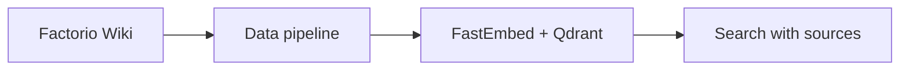

# Factorio Wiki RAG


An educational retrieval project for [Factorio Wiki](https://wiki.factorio.com/), covering items, recipes, research and mechanics from the base game and Space Age. English articles are collected, cleaned and split into source-linked chunks, then embedded with FastEmbed and searched through local Qdrant.

**Implemented:** data collection, preprocessing, indexing and vector search. **Next:** LLM answers grounded in retrieved passages and a Streamlit interface.



## Layout

```text
src/
├── data_pipeline/    # parser.py and preprocess.py
└── database/         # index.py and query.py
data/                 # Raw pages, cleaned articles and chunks
qdrant_db/            # Local vector database
clear_raw.bat
clear_processed.bat
requirements.txt
```

See the [source overview](src/README.md), [data pipeline](src/data_pipeline/README.md) and [database](src/database/README.md). Generated data, the database and virtual environments are excluded from Git.

## Setup and run

Requires Python 3.10+. Run these PowerShell commands from the repository root after cloning it. Internet access is needed for installation, collection and the initial model download.

```powershell
python -m venv .venv
.\.venv\Scripts\python.exe -m pip install -r requirements.txt

.\.venv\Scripts\python.exe -m src.data_pipeline.parser
.\.venv\Scripts\python.exe -m src.data_pipeline.preprocess
.\.venv\Scripts\python.exe -m src.database.index
.\.venv\Scripts\python.exe -m src.database.query
```

The indexer reads `data/processed/chunks.jsonl` from the project root. Its input path is adjusted for the relocated layout; the remaining database logic is unchanged.

If a complete raw dataset is already available, start with preprocessing. To resume an incomplete collection, run the parser again; it skips existing files and downloads missing pages. To refresh saved pages from the Wiki, clear raw first and repeat the pipeline.

From the repository root, Qdrant persists in `qdrant_db/`; run indexing and search sequentially. The model is `BAAI/bge-small-en-v1.5` (384 dimensions). Search uses a fixed English query and section filter defined in `query.py`, and prints passages and similarity scores. Scores are not confidence probabilities; source URLs remain in the stored metadata.

## Cleanup

Run `clear_raw.bat` or `clear_processed.bat` from the root, or double-click the required script. Each immediately clears and recreates only its matching `data/` folder; the vector database is preserved. A Python executable must be available in PATH. After changing chunks, reindex the database; see [rebuild notes](src/database/README.md#indexing).

Wiki revisions are recorded per page; the corpus is not pinned to one game release. Wiki content is available under [CC BY-NC-SA 3.0](https://creativecommons.org/licenses/by-nc-sa/3.0/) unless stated otherwise. Source links are retained.
